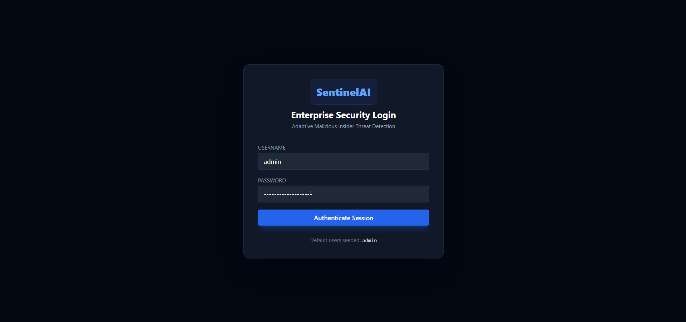
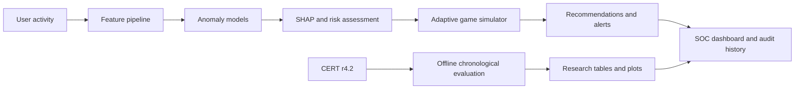

<p align="center">
  
</p>

<p align="center"><strong>Understand suspicious behaviour. Explain the risk. Explore an adaptive response.</strong></p>

<p align="center">
  <a href="https://github.com/nimeshupadhyay12/Sentinel-AI/actions/workflows/verify.yml"></a>
  
  
  
  
</p>

<p align="center">
  <a href="#screenshots">Screenshots</a> · <a href="#quick-start">Quick start</a> · <a href="docs/DEVELOPMENT.md">Developer guide</a> · <a href="#research">Research</a>
</p>

SentinelAI is a full-stack cybersecurity research project that brings together anomaly detection, SHAP explanations, a security operations dashboard, and a simulator for adaptive insider threats. It explores what happens when an insider changes behaviour after a defensive response.

**Built by [Nimesh Upadhyay](https://github.com/nimeshupadhyay12).**

> **Research prototype:** defensive actions are simulated recommendations. The application does not enforce endpoint controls. Its live detector uses synthetic baseline data; offline CERT evaluation is a separate research workflow.

## What you can explore

| Capability | What it does |
|---|---|
| **Explainable anomaly detection** | Scores activity with Isolation Forest and One-Class SVM, then displays SHAP feature attributions. |
| **Adaptive threat simulation** | Models attacker behaviour across multiple turns and evaluates defender responses with a finite, pure-strategy Stackelberg game. |
| **SOC dashboard** | Shows user activity, risk, alerts, incidents, and recent assessments in one interface. |
| **Adaptation metrics** | Tracks Attacker Adaptation Score (AAS) and observational Response Effectiveness Score (RES). |
| **Research workbench** | Provides chronological CERT r4.2 evaluation, model comparisons, ablations, tables, and plots. |
| **Authenticated API** | Uses JWT authentication, role checks, and SQLAlchemy persistence with SQLite or PostgreSQL. |

## Screenshots

### Security operations dashboard


*A supplied demonstration capture of the SOC interface. Values are example observations, not a benchmark or live service status.*

| Threat simulator | Audit telemetry |
|:---:|:---:|
|  |  |
| Explore attacker scenarios and response recommendations. | Inspect recorded activity and audit events. |

| Sign in | Research comparisons |
|:---:|:---:|
|  |  |
| Enter the authenticated workspace. | Compare model and policy variants. |

<details>
<summary><strong>View the end-to-end workflow and architecture</strong></summary>


</details>

Some supplied captures and diagrams show earlier terminology. The implemented game is pure-strategy, endpoint enforcement is simulated, and the cryptography modules are demonstrations rather than post-quantum implementations.

## How it works



The interactive application and offline experiments use different data paths. Simulator payoffs are explicit assumptions; RES does not establish causal effectiveness.

## Quick start

Use **Python 3.11**, **Node.js 20**, and npm. SQLite works locally without a separate database service. These commands use Windows PowerShell.

```powershell
git clone https://github.com/nimeshupadhyay12/Sentinel-AI.git
cd Sentinel-AI/backend
py -3.11 -m venv .venv
.\.venv\Scripts\python.exe -m pip install -r requirements-dev.txt
Copy-Item .env.example .env
py -3.11 -c "import secrets; print(secrets.token_hex(32))"
```

In `backend/.env`, replace `SECRET_KEY` with the generated value. Set unique values for `SENTINEL_BOOTSTRAP_ADMIN_PASSWORD`, `SENTINEL_BOOTSTRAP_ANALYST_PASSWORD`, and `SENTINEL_BOOTSTRAP_USER_PASSWORD` to create the optional `admin`, `analyst`, and `insider_target` accounts on first startup. There is no shared demo password.

Start the backend:

```powershell
.\.venv\Scripts\python.exe -m uvicorn app.main:app --reload --host 127.0.0.1 --port 8000
```

In a second terminal, from the repository root:

```powershell
cd frontend
npm ci
npm run dev
```

Open **[the dashboard](http://localhost:3000)** and sign in with a configured account. Explore **[API documentation](http://127.0.0.1:8000/docs)** or the **[health endpoint](http://127.0.0.1:8000/health)**.

For PostgreSQL, all environment options, Docker, deployment, and experiment commands, see the **[developer guide](docs/DEVELOPMENT.md)**.

## Technology

| Layer | Stack |
|---|---|
| Frontend | React 18 · Vite · Tailwind CSS · Recharts · Lucide |
| Backend | Python · FastAPI · Uvicorn · Pydantic |
| ML and explainability | scikit-learn · SHAP · NumPy · pandas · SciPy |
| Storage and authentication | SQLAlchemy · SQLite / PostgreSQL · JWT · bcrypt |
| Verification and packaging | pytest · HTTPX · GitHub Actions · Docker · Render blueprint |

## Project structure

```text
Sentinel-AI/
├── backend/              # API, models, research modules, and tests
├── frontend/             # React dashboard and simulator
├── docs/                 # Setup, configuration, and research guide
├── images/               # Project screenshots, diagrams, and banner
├── research/
│   └── results/          # Selected supplied aggregate experiment outputs
├── .github/workflows/    # Application verification and optional keep-alive
├── Dockerfile            # Combined frontend + backend container
└── render.yaml           # Deployment blueprint
```

## Verification

Backend tests, after installing the development requirements:

```powershell
cd backend
.\.venv\Scripts\python.exe -m pytest tests -q
```

Frontend production build, in another terminal from the repository root:

```powershell
cd frontend
npm ci
npm run build
```

The included GitHub Actions workflow builds the frontend and runs backend tests against a disposable PostgreSQL service. See the workflow badge for its current result. The badge reflects GitHub Actions results for this repository; local validation does not imply a fresh deployment.

## Research

The project includes CERT r4.2 preprocessing and chronological train/validation/test evaluation, plus a separate synthetic adaptive-response simulator. Selected aggregate results supplied with the project are included so the research dashboard has example artifacts. Raw CERT data, user-level feature datasets, credentials, databases, and serialized models are excluded.

- [Research methods and reproduction](docs/DEVELOPMENT.md#research-reproduction)
- [Supplied enhanced-protocol report](research/results/cert-r4.2-enhanced/research-report.md)
- [Experiment provenance and limitations](research/results/cert-r4.2-enhanced/manifest.json)

Absolute detection performance remains limited. Five seeds and exploratory follow-up do not establish statistical significance or consistent superiority over the baselines. Synthetic response results must not be interpreted as CERT outcomes.

Dataset reference: Lindauer, Brian (2020). *Insider Threat Test Dataset*, Carnegie Mellon University. [Dataset DOI](https://doi.org/10.1184/R1/12841247.v1).

## Security and scope

Use synthetic or authorised data, configure strong secrets, and review deployment settings before exposing the application. The `pqc_kem.py` demonstration uses AES-GCM and `pqc_dsa.py` uses Ed25519; they do **not** implement ML-KEM or ML-DSA. See the [implementation limitations](docs/DEVELOPMENT.md#security-and-implementation-limitations) and [security policy](SECURITY.md).

## Contributing and license

Suggestions, bug fixes, and reproducibility improvements are welcome. Read [CONTRIBUTING.md](CONTRIBUTING.md) before submitting a change.

No reuse license has been selected. Contact the repository owner before redistributing or reusing the code.
