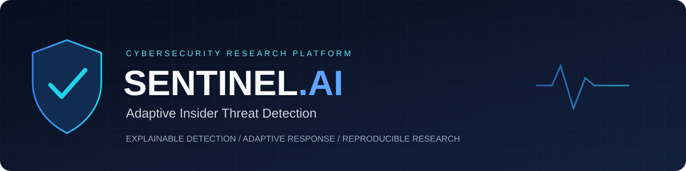
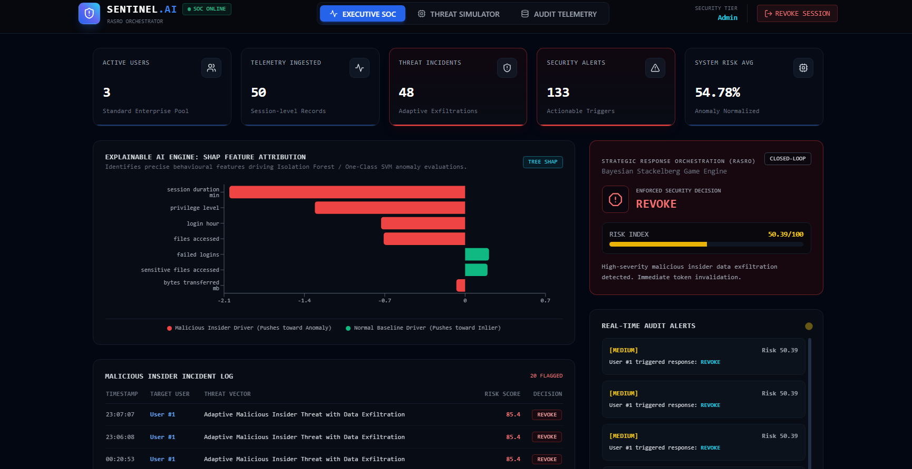
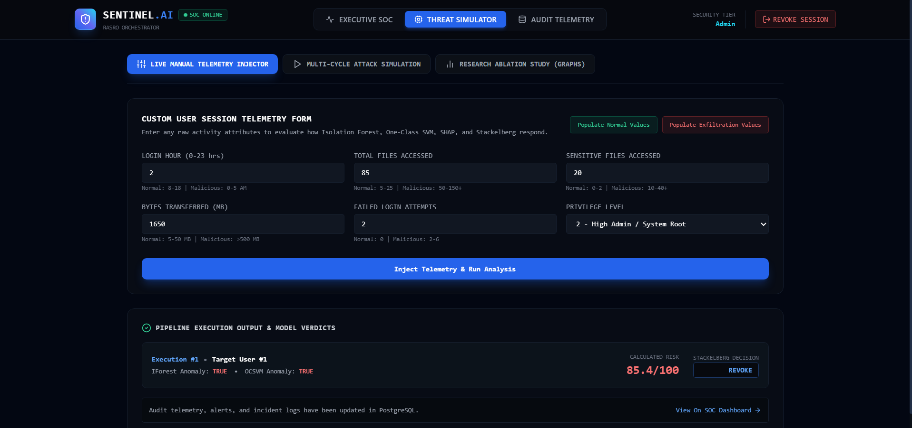
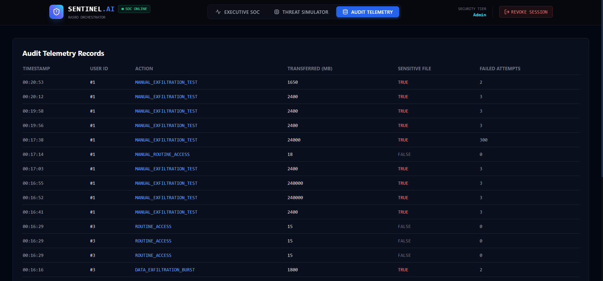
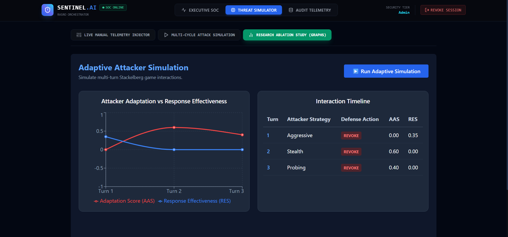
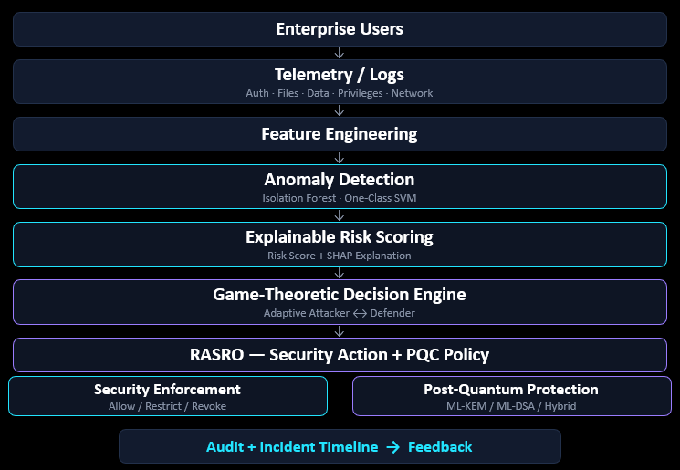
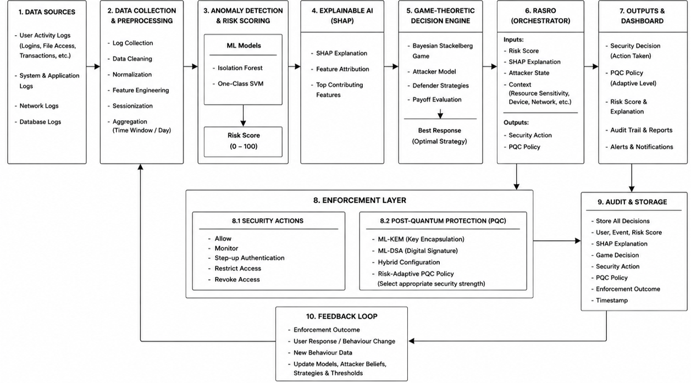
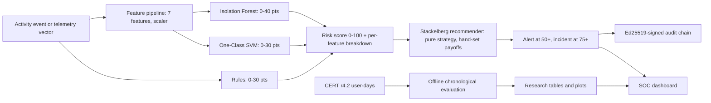

<p align="center">
  
</p>

<p align="center"><strong>Understand suspicious behaviour. Explain the risk. Explore an adaptive response.</strong></p>

<p align="center">
  <a href="https://github.com/nimeshupadhyay12/Sentinel-AI/actions/workflows/verify.yml"></a>
  
  
  
  
</p>

<p align="center">
  <a href="#screenshots">Screenshots</a> · <a href="#quick-start">Quick start</a> · <a href="docs/DEVELOPMENT.md">Developer guide</a> · <a href="#research">Research</a>
</p>

SentinelAI is a full-stack cybersecurity research project that brings together anomaly detection, SHAP explanations, a security operations dashboard, and a simulator for adaptive insider threats. It explores what happens when an insider changes behaviour after a defensive response.

**Built by [Nimesh Upadhyay](https://github.com/nimeshupadhyay12).**

> **Research prototype:** defensive actions are simulated recommendations. The application does not enforce endpoint controls. Its live detector uses synthetic baseline data; offline CERT evaluation is a separate research workflow.

## What you can explore

| Capability | What it does |
|---|---|
| **Explainable anomaly detection** | Scores activity with Isolation Forest and One-Class SVM and breaks **every point** of the 0-100 risk score down per feature: exact Shapley values for both models plus the rule points that fired. TreeSHAP on the Isolation Forest is also shown. |
| **Adaptive response recommender** | A finite, pure-strategy Stackelberg game with hand-set payoffs recommends ALLOW / MONITOR / STEP_UP_AUTH / RESTRICT / REVOKE. Recommendations only; nothing is enforced. |
| **Adaptive threat simulator** | A scripted attacker changes behaviour after each recommended response, so the loop can be studied over several turns. |
| **SOC dashboard** | User activity, risk, alerts, incidents, score breakdown and recent assessments; standard users only see their own activity. |
| **Adaptation metrics** | Attacker Adaptation Score (AAS) and observational Response Effectiveness Score (RES). |
| **Research workbench** | Chronological 60/20/20 CERT r4.2 evaluation, model comparisons, ablations, paired statistics, tables and plots. |
| **Secured API** | JWT access tokens with server-side revocation, rotating httpOnly refresh cookies, Admin/Analyst/User roles, login throttling, and an Ed25519-signed, verifiable audit chain. |

## Screenshots

### Security operations dashboard



*A supplied demonstration capture of the SOC interface. Values are example observations, not a benchmark or live service status.*

| Threat simulator | Audit telemetry |
|:---:|:---:|
|  |  |
| Explore attacker scenarios and response recommendations. | Inspect recorded activity and audit events. |

| Sign in | Research comparisons |
|:---:|:---:|
|  |  |
| Enter the authenticated workspace. | Compare model and policy variants. |

<details>
<summary><strong>View the end-to-end workflow and architecture</strong></summary>





</details>

Some supplied captures and diagrams predate the current version and show earlier terminology (for example "PQC" or "ML-DSA"). The implemented game is pure-strategy with hand-set payoffs, enforcement is simulated, and the cryptography is classical (Ed25519 signatures, AES-GCM demo), not post-quantum.

## How it works



**Risk score.** `risk = IF points (0-40) + OCSVM points (0-30) + rule points (0-30)`. Each model's decision value is mapped linearly onto its points range and clipped. The rules add 15 points for more than 300 MB transferred, 10 for 5 or more sensitive files, and 5 for activity before 06:00 or after 21:00. Both models are fitted on the benign rows of a synthetic baseline, because the live app has no real training data.

**Explanation.** For the IF and OCSVM points, SentinelAI computes exact interventional Shapley values: it evaluates all 2^7 = 128 feature coalitions against a fixed 20-row background of normal sessions. That is the quantity SHAP's KernelExplainer estimates, computed exhaustively, so there is no sampling error (about 70 ms per event). Rule points go to the one feature each rule tests. The result satisfies `baseline + sum(per-feature points) = risk score`, where the baseline is what a typical normal session scores, and it is stored with every assessment and alert.

**Recommendation.** For each of the 5 defender actions, the game finds the attacker's best response among 4 strategies (ties broken against the defender), then picks the action with the best defender utility. Payoffs are modelling assumptions, shifted by the current risk, AAS, RES and the previous defence. It is not a Bayesian or mixed-strategy game, and it is not fitted to data.

The interactive application and the offline experiments use different data paths. RES is observational and does not establish causal effectiveness.

## Quick start

Use **Python 3.11**, **Node.js 20**, and npm. SQLite works locally without a separate database service. These commands use Windows PowerShell.

```powershell
git clone https://github.com/nimeshupadhyay12/Sentinel-AI.git
cd Sentinel-AI/backend
py -3.11 -m venv .venv
.\.venv\Scripts\python.exe -m pip install -r requirements-dev.txt
Copy-Item .env.example .env
py -3.11 -c "import secrets; print(secrets.token_hex(32))"
```

In `backend/.env`, replace `SECRET_KEY` with the generated value. Set unique values for `SENTINEL_BOOTSTRAP_ADMIN_PASSWORD`, `SENTINEL_BOOTSTRAP_ANALYST_PASSWORD`, and `SENTINEL_BOOTSTRAP_USER_PASSWORD` to create the optional `admin`, `analyst`, and `insider_target` accounts on first startup. There is no shared demo password.

Start the backend:

```powershell
.\.venv\Scripts\python.exe -m uvicorn app.main:app --reload --host 127.0.0.1 --port 8000
```

In a second terminal, from the repository root:

```powershell
cd frontend
npm ci
npm run dev
```

Open **[the dashboard](http://localhost:3000)** and sign in with a configured account. Explore **[API documentation](http://127.0.0.1:8000/docs)** or the **[health endpoint](http://127.0.0.1:8000/health)**.

Self-registration is off by default (`ALLOW_SELF_REGISTRATION=false`). The admin account creates other accounts with `POST /api/users/`.

## API and roles

All endpoints except `/health`, login, refresh, logout and the optional register endpoint need `Authorization: Bearer <access token>`. The role is read from the database on every request, so a demotion or deactivation applies immediately.

| Method | Path | Who |
|---|---|---|
| POST | `/api/auth/login` | Anyone. Rate limited: account lockout plus per-IP budget |
| POST | `/api/auth/refresh` | Holder of the httpOnly refresh cookie. Rotated on every use; reuse revokes the whole family |
| POST | `/api/auth/logout` | Anyone. Denylists the access token's `jti` and revokes the refresh token |
| POST | `/api/auth/register` | Anyone, only if `ALLOW_SELF_REGISTRATION=true`. Always creates a `User`; same 202 reply whether or not the account exists |
| GET | `/api/auth/me` | Any signed-in user |
| POST | `/api/activities/log` | Any signed-in user (records and scores their own event) |
| GET | `/api/activities/recent` | User: own activity only. Analyst, Admin: everyone |
| POST | `/api/activities/analyze` | Analyst, Admin |
| GET | `/api/alerts/`, `/api/incidents/` | Analyst, Admin |
| GET | `/api/analytics/dashboard-stats` | Analyst, Admin |
| POST | `/api/analytics/simulate-threat` | Analyst, Admin |
| POST | `/api/experiments/run-adaptive-ablation` | Analyst, Admin |
| GET | `/api/research/results`, `/api/research/files/{name}` | Analyst, Admin |
| GET | `/api/users/` | Analyst, Admin |
| POST | `/api/users/` | Admin (create an account with a role) |
| PATCH | `/api/users/{id}` | Admin (change role, activate or deactivate; ends that user's sessions) |
| GET | `/api/audit/verify` | Admin. Re-checks every chain link and every Ed25519 signature |
| GET | `/api/audit/public-key`, `/api/audit/logs` | Admin |

**Token storage trade-off.** The 15-minute access token is kept in JavaScript memory only, not in `localStorage`. The 7-day refresh token is an httpOnly, `SameSite=Strict` cookie scoped to `/api/auth`, so injected script cannot read a long-lived credential. The SPA is served with a strict Content-Security-Policy (`script-src 'self'`, no inline scripts). An XSS bug could still act as the user while the page is open; that risk remains for any browser-held credential.

For PostgreSQL, all environment options, Docker, deployment, and experiment commands, see the **[developer guide](docs/DEVELOPMENT.md)**.

## Technology

| Layer | Stack |
|---|---|
| Frontend | React 18 · Vite · Tailwind CSS · Recharts · Lucide |
| Backend | Python · FastAPI · Uvicorn · Pydantic |
| ML and explainability | scikit-learn · SHAP · NumPy · pandas · SciPy |
| Storage and security | SQLAlchemy · SQLite / PostgreSQL · JWT (python-jose) · bcrypt · Ed25519 (cryptography) |
| Verification and packaging | pytest · ruff · GitHub Actions · Docker (non-root) · Render blueprint with PostgreSQL |

## Project structure

```text
Sentinel-AI/
├── backend/              # API, models, research modules, and tests
├── frontend/             # React dashboard and simulator
├── docs/                 # Setup, configuration, and research guide
├── images/               # Project screenshots, diagrams, and banner
├── research/
│   └── results/          # Selected supplied aggregate experiment outputs
├── .github/workflows/    # CI (lint, tests, frontend build) and optional keep-alive
├── Dockerfile            # Frontend + backend container, runs as non-root
└── render.yaml           # Render blueprint: web service + PostgreSQL
```

## Verification

Backend tests, after installing the development requirements:

```powershell
cd backend
.\.venv\Scripts\python.exe -m pytest tests -q
```

Frontend production build, in another terminal from the repository root:

```powershell
cd frontend
npm ci
npm run build
```

The CI workflow runs `ruff check`, the backend tests against a disposable PostgreSQL 16 service (with the frontend built so the SPA tests run), and a standalone frontend build. Locally, without `SENTINEL_TEST_DATABASE_URL`, the PostgreSQL-only migration test is skipped.

## Research

The project includes CERT r4.2 preprocessing and a chronological 60/20/20 train/validation/test evaluation (split by date, so models never train on the future), plus a separate synthetic adaptive-response simulator. Selected aggregate results are committed so the research dashboard has artifacts. Raw CERT data, user-level feature datasets, credentials, databases and serialized models are excluded.

Committed results of the enhanced protocol, mean of 5 seeds, from [`detection-summary.csv`](research/results/cert-r4.2-enhanced/detection-summary.csv). The test split has 61,473 user-days, of which 244 (0.40%) fall inside insider windows.

| Model | ROC-AUC | Precision | Recall | F1 |
|---|---:|---:|---:|---:|
| Isolation Forest | 0.834 | 0.013 | 0.054 | 0.016 |
| One-Class SVM | 0.632 | 0.014 | 0.045 | 0.021 |
| Full SentinelAI (adaptive policy) | 0.799 | 0.011 | 0.102 | 0.020 |

How to read this: the Isolation Forest ranks insider days above normal days well above chance (ROC-AUC 0.83), but at 0.40% prevalence only about 1 alert in 75-90 is a true insider day. The adaptive policy's differences from the baselines are not statistically significant (Holm-corrected paired sign-flip tests in [`paired-comparisons.csv`](research/results/cert-r4.2-enhanced/paired-comparisons.csv)). The enhanced protocol already includes a per-user baseline representation (`personalized_log1p`: each feature's deviation from that user's own training median), selected on validation data only.

Reproduce (needs the CERT r4.2 archive and answer key, which are not redistributed here):

```powershell
cd backend
python -m research.download_cert --output ../research/data/raw/r4.2.tar.bz2
python -m research.preprocess_cert --archive ../research/data/raw/r4.2.tar.bz2 --answers ../research/data/raw/answers.tar.bz2 --output ../research/data/cert_r4.2_features.csv
python run_experiments.py --dataset ../research/data/cert_r4.2_features.csv --output ../research/results/cert-r4.2-enhanced --protocol enhanced --seeds 0 1 2 3 4 --episodes 20 --turns 8
```

`python run_experiments.py --demo --output <dir>` runs the same pipeline on synthetic data as a smoke test. The synthetic data is easy to separate (both detectors reach ROC-AUC 1.000 on it), so those numbers say nothing about real-world performance.

- [Research methods and reproduction](docs/DEVELOPMENT.md#research-reproduction)
- [Committed enhanced-protocol report](research/results/cert-r4.2-enhanced/research-report.md)
- [Experiment provenance and limitations](research/results/cert-r4.2-enhanced/manifest.json)
- [What changed in this version, and why](docs/IMPROVEMENTS.md)

Dataset reference: Lindauer, Brian (2020). *Insider Threat Test Dataset*, Carnegie Mellon University. [Dataset DOI](https://doi.org/10.1184/R1/12841247.v1).

## Security and scope

Use synthetic or authorised data, configure strong secrets, and review deployment settings before exposing the application. `app/core/audit_signing.py` (formerly `pqc_dsa.py`) uses classical Ed25519 and `app/core/aesgcm_demo.py` (formerly `pqc_kem.py`) is an AES-GCM demo; neither implements ML-DSA, ML-KEM or anything post-quantum. Login throttling is in-process, so run a single worker or move it to a shared store. See the [implementation limitations](docs/DEVELOPMENT.md#security-and-implementation-limitations) and [security policy](SECURITY.md).

## Contributing and license

Suggestions, bug fixes, and reproducibility improvements are welcome. Read [CONTRIBUTING.md](CONTRIBUTING.md) before submitting a change.

Released under the [MIT License](LICENSE).
